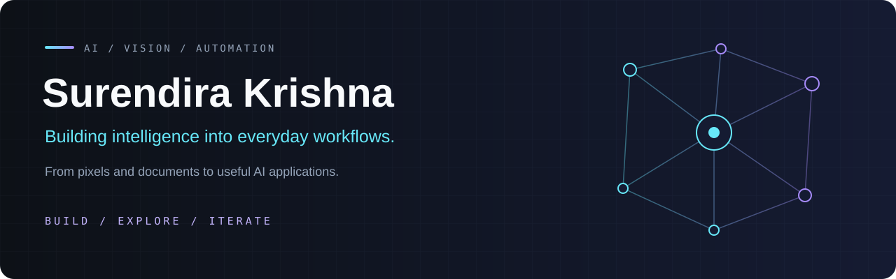

<p align="center">
  
</p>

<p align="center">
  <a href="https://github.com/Surendirakrishna?tab=repositories"></a>
  <a href="https://github.com/Surendirakrishna/GLM-OCR"></a>
  <a href="https://github.com/Surendirakrishna/reidentification"></a>
</p>

### Hey, I'm Surendira 👋

I build projects that turn **images, documents, and data into useful applications**. My work here spans computer vision, document intelligence, machine learning, and workflow automation.

- **Computer vision** — detection, tracking, and person re-identification across cameras.
- **Document AI** — multilingual OCR, layout understanding, and extracting tables.
- **Privacy tooling** — detecting and masking sensitive information in images.
- **Automation** — reducing repetitive work with Python and UiPath.

---

### Selected builds

<table>
<tr>
<td width="50%" valign="top">

#### 🧠 [GLM-OCR](https://github.com/Surendirakrishna/GLM-OCR)
A document pipeline combining layout detection and vision-language models for English, Indian languages, and tables.

**Document AI · Multilingual OCR · FastAPI · Docker**

</td>
<td width="50%" valign="top">

#### 👁️ [Multi-Camera Re-Identification](https://github.com/Surendirakrishna/reidentification)
Detect, track, and match people across camera streams, with annotated video, a person gallery, and reports.

**YOLO · OC-SORT · OSNet · Streamlit**

</td>
</tr>
<tr>
<td width="50%" valign="top">

#### 🛡️ [OCR + PII Masking](https://github.com/Surendirakrishna/ocr-pii-masking-pipeline)
Extract text from images, detect personally identifiable information, and visually redact sensitive data.

**OCR · Privacy · Image Processing**

</td>
<td width="50%" valign="top">

#### ⚙️ [Resume Screener](https://github.com/Surendirakrishna/Resume-Screener-)
An automated resume screening workflow built with UiPath.

**Workflow Automation · UiPath · RPA**

</td>
</tr>
</table>

<p align="center">
  <a href="https://github.com/Surendirakrishna?tab=repositories"><strong>Explore all repositories →</strong></a>
</p>

---

### Tools I work with

<p>
  
  
  
  
  
  
  
  
</p>

### What connects the work

```text
Images & documents  →  Models & pipelines  →  Useful applications
```

I enjoy working across the whole pipeline: preparing inputs, connecting models, and building interfaces that make the results easy to explore.

<p align="center">
  <sub>Always building. Always learning.</sub>
</p>
